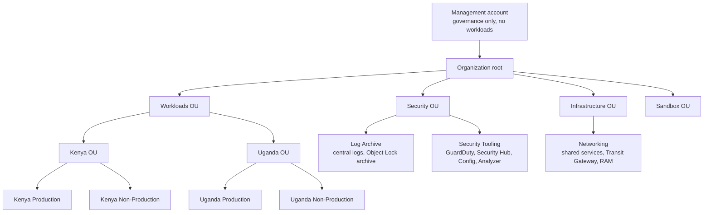

# SAP_Retail landing zone architecture

## Designed organization structure

This is the organization structure described in the LZ Solution Offering Partner Questionnaire (Q1).
Every account named there appears here, in the OU the questionnaire places it in, and every one is
declared in `templates/01-org/organization.yaml` with its OU parent, primary email and tag set.

Per-account rollout status is tracked in [`audit/matrix.md`](../audit/matrix.md) rather than in this
diagram, so the architecture stays stable as accounts are brought online.

Two OUs go beyond the questionnaire tree: **Infrastructure**, which holds the Networking account so
shared networking is owned outside any workload account, and **Sandbox**, which is isolated from
corporate connectivity by SCP. Both are additions, not substitutions.

## Account roles

| Account | OU | Role |
|---|---|---|
| Management | Root | Billing, SCPs, Identity Center, organization governance. No workloads, no standing human access by design. Never created by CloudFormation. |
| Log Archive | Security | Destination for the organization CloudTrail, Config and access logs. Holds the write-once Object Lock archive. |
| Security Tooling | Security | Delegated administrator for GuardDuty, Security Hub and Access Analyzer. Findings from every account aggregate here. |
| Networking | Infrastructure | Shared services and the Transit Gateway, shared to the organization by RAM. |
| Kenya Production | Workloads / Kenya | SAP production workload. |
| Kenya Non-Production | Workloads / Kenya | SAP non-production workload. Instance scheduler and tighter instance-type limits apply. |
| Uganda Production | Workloads / Uganda | SAP production workload for Uganda. |
| Uganda Non-Production | Workloads / Uganda | SAP non-production workload for Uganda. |

## Design notes

- Member accounts are declared in `templates/01-org/organization.yaml`, each behind its own
  approval gate, and are placed directly into their target OU at creation. No pre-existing account
  was moved or invited into this organization.
- Account display names were set with `aws account put-account-name`, because CloudFormation
  cannot rename an account (design decision 22).
- Every workload account owns a two-AZ VPC with public and private subnet separation; databases sit
  in private subnets with no inbound internet path. The Networking account owns the Transit Gateway
  and shared services. CIDR ranges are allocated from the reviewed plan in
  `config/network/cidr-plan.yaml` and do not overlap across countries, so inter-country routing can
  be added later without re-addressing (design decision 26).
- Security Tooling and Log Archive are deliberately separate Security OU functions: the account
  that reviews findings is not the account that stores the evidence.
- Control Tower manages its own log buckets, which cannot have Object Lock applied after creation.
  The write-once archive is a separate Object Lock bucket fed by S3 replication, with a 1,460-day
  GOVERNANCE default (design decisions 13, 14 and 18).
- Account creation is gated per account in `config/parameters/organization.json`. Each gate also
  requires a primary email address, so an account cannot be created by accident or with a reused
  address. Accounts are placed in their target OU at creation.
- The live Kenya SAP estate and the Data Platform workload are in a different organization. They
  are never deployment targets here, and `scripts/repo-policy.ps1` fails the build if one of their
  account identifiers appears in a template or parameter file.

## Delivery controls

`deploy.ps1` fails closed unless the caller is the management account, all parameters are resolved,
and no Control Tower operation is in progress. It creates review-only change sets; execution stays
a manual, approved runbook action. The GitHub OIDC roles are limited to the configured repository,
ref and environment claims.