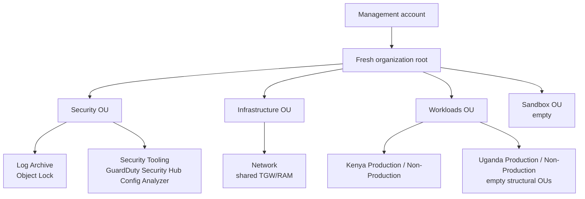

# SAP_Retail fresh landing zone architecture

- The management account bootstraps the fresh organization; it is never created by CloudFormation.
- Four member accounts (Log Archive, Security Tooling, Networking, Kenya Non-Production) are declared in `templates/01-org/organization.yaml`, each with its own enable flag, and sit in their target OUs. Their display names were set with `aws account put-account-name` because CloudFormation cannot rename an account (design decision 22). No pre-existing account was moved or invited.
- Every approved workload account owns a two-AZ VPC. The Network account provides separately owned shared services and Transit Gateway. CIDR, route, VPN and DNS ownership require a signed dependency map and smoke tests.
- Security Tooling and Log Archive are separate Security OU functions. The Log Archive bucket is encrypted, versioned, retained and Object Lock protected with a 1,460-day GOVERNANCE default. Control Tower keeps its own managed log buckets (no Object Lock); the write-once archive is fed from them by S3 replication (design decisions 13, 14 and 18).
- Uganda has no account, VPC, StackSet instance, assignment, VPN, monitoring, or cost deployment. `eu-west-1` is a proposed operating region, not an AWS Uganda Region.
- Data Platform is protected from VPC, workload, StackSet, invitation, enrollment and OU-move actions until its separately approved compatibility and migration window.

## Delivery controls
`deploy.ps1` fails closed unless the caller is account `<MANAGEMENT_ACCOUNT_ID>`, all parameters are resolved, and no Control Tower operation is in progress. It creates review-only change sets; execution remains a manual, approved runbook action. The GitHub OIDC roles are limited to the configured repository/ref/environment claims.
